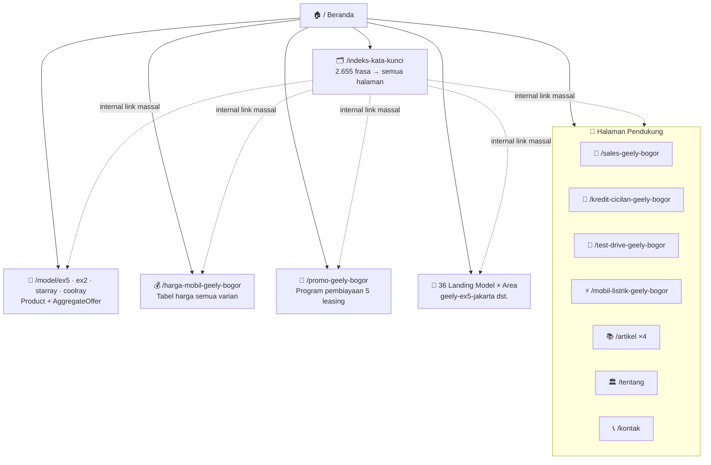

<div align="center">

# 🚗 PUSAT GEELY

### *Website Konsultan Penjualan Geely №1 untuk Bogor & Jabodetabek*

**EX5 · EX2 · Starray EM-i · Coolray** — Test Drive Fleksibel · Harga Transparan · Simulasi Kredit · Trade-in

[](https://nextjs.org)
[](https://react.dev)
[](https://typescriptlang.org)
[](https://tailwindcss.com)
[](https://prisma.io)
[](https://bun.sh)

[](#-seo-full-power-arsitektur)
[](#-seo-full-power-arsitektur)
[](#-seo-full-power-arsitektur)
[](#-seo-full-power-arsitektur)

*44 pintu masuk pencarian · 2.655 frasa kata kunci · IndexNow instan · Knowledge Graph terhubung*

</div>

---

<div align="center">

**🌐 Live** — [pusatgeely.web.id](https://pusatgeely.web.id) · **💬 WhatsApp** — [+62 816-6111-42](https://wa.me/62816611142) · **📄 Indeks Keyword** — [/indeks-kata-kunci](https://pusatgeely.web.id/indeks-kata-kunci)

</div>

---

## ✨ Tentang Proyek Ini

**Pusat Geely** bukan sekadar website dealer — ini adalah **mesin pencarian-assisted selling** yang dibangun dengan satu filosofi: *setiap pertanyaan yang orang Indonesia ketik di Google tentang Geely harus punya pintu masuk ke halaman ini*.

Website ini melayani **Konsultan Penjualan Independen** (bukan dealer resmi — dan jujur soal itu) untuk seluruh lineup Geely Indonesia: **Geely EX5** (SUV listrik), **Geely EX2** (hatchback listrik), **Geely Starray EM-i** (SUV super hybrid), dan **Geely Coolray** (crossover turbo) di wilayah **Bogor, Depok, Jakarta, Tangerang, Bekasi, dan sekitarnya**.

Yang membuatnya berbeda dari website mobil pada umumnya:

| 🔍 Yang Dibangun | 🎯 Hasilnya |
|---|---|
| Arsitektur keyword engine 2.655 frasa | Cakupan long-tail dari *"harga geely ex5 bogor"* hingga *"cara kredit geely coolray jakarta"* |
| 44 halaman landing programatik | Setiap kombinasi **model × area** punya halaman bermutu dengan konten unik per-area |
| JSON-LD Knowledge Graph 9 tipe | Google memahami bisnis, produk, harga, FAQ, orang, dan organisasi di baliknya |
| IndexNow bridge | Bing, Yandex & Seznam tahu konten baru **dalam hitungan detik**, bukan hari |
| Prinsip *honesty-first* | Semua harga indikatif + disclaimer — membangun trust dan aman dari penalti |

---

## 📖 Daftar Isi

- [🛠️ Tech Stack](#️-tech-stack)
- [🚀 Quick Start](#-quick-start)
- [⚡ SEO Full Power (Arsitektur)](#-seo-full-power-arsitektur)
- [🗺️ Arsitektur Halaman](#️-arsitektur-halaman)
- [📊 Struktur Data (JSON-LD Matrix)](#-struktur-data-json-ld-matrix)
- [🗂️ Struktur Proyek](#️-struktur-proyek)
- [📡 IndexNow — Indeks Instan](#-indexnow--indeks-instan)
- [🚢 Deployment](#-deployment)
- [✅ Checklist Go-Live SEO](#-checklist-go-live-seo)
- [🧭 Prinsip Desain](#-prinsip-desain)
- [👤 Kredit & Support System](#-kredit--support-system)
- [📜 Lisensi](#-lisensi)

---

## 🛠️ Tech Stack

| Layer | Teknologi | Kenapa Dipilih |
|---|---|---|
| **Framework** | Next.js 16 (App Router, Turbopack) | SSG + metadata streaming + Image Optimization native |
| **UI** | React 19 + shadcn/ui + Radix | Aksesibel, composable, production-grade |
| **Styling** | Tailwind CSS 4 + tw-animate | Utility-first, zero-runtime CSS |
| **Bahasa** | TypeScript 5 (strict) | Tipe data produk & SEO jadi kontrak, bukan harapan |
| **Database** | Prisma 6 + SQLite | Lead capture berbasis database, zero-config |
| **Animasi** | Framer Motion | Reveal on scroll yang halus tanpa jank |
| **Runtime** | Bun 1.3 | Install & start secepat kilat (827 paket < 10 detik) |
| **Bilingual** | Custom i18n (ID/EN) | Seluruh konten dua bahasa tanpa dependensi eksternal |

---

## 🚀 Quick Start

```bash
# 1️⃣ Clone
git clone https://github.com/prabudanling/pusatgeely.git
cd pusatgeely

# 2️⃣ Install (Bun — disarankan)
bun install

# 3️⃣ Database (SQLite — otomatis)
bun run db:push && bun run db:generate

# 4️⃣ Development
bun run dev          # → http://localhost:3000

# 5️⃣ Production
bun run build        # SSG semua 50+ halaman
bun run start        # Standalone server
```

> 💡 **Tanpa Bun?** `npm install && npm run dev:next dev` juga jalan — hanya lebih lambat.

### Environment Variables (opsional)

```bash
NEXT_PUBLIC_GA_ID=G-XXXXXXXXXX                        # Aktifkan Google Analytics 4
NEXT_PUBLIC_GOOGLE_SITE_VERIFICATION=xxx              # Google Search Console
NEXT_PUBLIC_BING_VERIFICATION=xxx                     # Bing Webmaster Tools
NEXT_PUBLIC_YANDEX_VERIFICATION=xxx                   # Yandex Webmaster
```

Tanpa env apa pun → website tetap berjalan penuh, **nol script analitik, nol beban**.

---

## ⚡ SEO FULL POWER (Arsitektur)

Bagian ini yang membuat setiap pencarian Geely punya peluang besar mendarat di website kita:

### 1. 🧠 Keyword Engine — `src/lib/seo-keywords.ts`

```mermaid
flowchart LR
    A[4 Model<br/>EX5·EX2·Starray·Coolray] --> D{Kombinatorik<br/>Deterministik}
    B[25 Area<br/>Bogor→BSD] --> D
    C[20 Intent<br/>harga·kredit·test drive] --> D
    D --> E[Grid A: Model × Intent × Area<br/>2.000 frasa]
    D --> F[Grid B: Intent × Area<br/>300 frasa]
    D --> G[Grid C: EV & Hybrid<br/>108 frasa]
    D --> H[Pertanyaan Alami<br/>107 frasa]
    D --> I[Brand + Warna/Spec + Tahun<br/>140 frasa]
    E & F & G & H & I --> J[(2.655 frasa unik<br/>+ route tujuan)]
    J --> K[meta keywords<br/>per halaman]
    J --> L[/indeks-kata-kunci<br/>hub 2.655 internal link]
    J --> M[JSON-LD keywords]
```

**Prinsip anti-spam yang dipatuhi:** setiap frasa **wajib** menunjuk ke halaman nyata yang menjawabnya. Tidak ada keyword stuffing, tidak ada frasa fiktif — mesin pencari menghargai itu, dan pembeli pun menerima jawaban yang benar.

### 2. 🏭 Landing Grid Programatik — `src/lib/landing-grid.ts`

```
4 Model × 9 Area (Jakarta, Depok, Tangerang, Bekasi,
Sentul, Cibinong, Cibubur, BSD, Kab. Bogor)
= 36 halaman + 8 halaman manual + halaman statis
= 44 pintu masuk pencarian
```

Setiap halaman grid bukan halaman tipis — membawa:

- ✅ **Tabel harga varian asli** (dari `MODELS`, indikatif OTR)
- ✅ **Flavor teks khusus per-area** (Jakarta ≠ Sentul ≠ BSD — konteks lokal nyata)
- ✅ **5 FAQ lokal** (rotasi deterministik dari 8 template)
- ✅ **Simulator kredit interaktif** + form test drive + program pembiayaan
- ✅ **5 internal link** ke halaman saudara (grid link matrix)
- ✅ **Metadata lengkap**: title, description, canonical, OG, Twitter, keywords

### 3. 🗺️ Teknis On-Page

| Teknik | Status | Lokasi |
|---|---|---|
| Canonical + hreflang (id-ID/en) | ✅ | Semua halaman |
| OpenGraph + Twitter Card | ✅ | Semua halaman |
| `robots.txt` + `sitemap.xml` dinamis | ✅ | `app/robots.ts`, `app/sitemap.ts` |
| PWA Manifest | ✅ | `app/manifest.ts` |
| Image Optimization (WebP, lazy) | ✅ | `next/image` |
| Bilingual hreflang | ✅ | Layout + semua route |
| Breadcrumb visual + JSON-LD | ✅ | Semua halaman konten |
| `humans.txt` | ✅ | `public/humans.txt` |
| Verifikasi Search Console (3 mesin) | ✅ | via env, zero-config |

---

## 🗺️ Arsitektur Halaman



---

## 📊 Struktur Data (JSON-LD Matrix)

Sembilan tipe schema.org bekerja sama membentuk **Knowledge Graph** yang utuh:

| JSON-LD | Tipe | Isi Kunci |
|---|---|---|
| `layout.tsx` | `AutoDealer` | Bisnis, jam, area layanan, telepon, price range, `sameAs` sosial |
| `layout.tsx` | `FAQPage` | 8 FAQ nyata → rich result dropdown di Google |
| `layout.tsx` | `WebSite` | Publisher + provider (support system) |
| `layout.tsx` | `@graph` | **2 Person + 3 Organization** saling ter-link `@id` |
| `[landing]/page.tsx` | `BreadcrumbList` | Jejak navigasi semua landing |
| `[landing]/page.tsx` | `FAQPage` | FAQ lokal per halaman |
| `[landing]/page.tsx` | `Service` / `ItemList` | Layanan konsultasi / daftar varian |
| `model/[slug]/page.tsx` | `Product + AggregateOffer` | Harga low/high + offer per varian |
| `artikel/[slug]/page.tsx` | `Article` | Author, tanggal, publisher |
| `indeks-kata-kunci/page.tsx` | `CollectionPage + ItemList` | Peta topik situs |

> 🔍 **Bonus tersembunyi:** Person schema **H. Gugun Gunara** (alias *prabudanling* · *santri angon*) & **Muhammad Lutfi Azmi** + organisasi **PT Top Konsultan Internasional** & **PT Digital Bisnis Manajemen** terhubung ke 6 profil sosial via `sameAs` — jalur resmi Google Knowledge Graph. Hadir di balik layar, tidak mengganggu permukaan UI. Lihat [`src/lib/branding.ts`](src/lib/branding.ts).

---

## 🗂️ Struktur Proyek

```
pusatgeely/
├── src/
│   ├── app/
│   │   ├── layout.tsx              # Metadata global + Knowledge Graph + GA4 opsional
│   │   ├── page.tsx                # Beranda
│   │   ├── [landing]/page.tsx      # Router 44 halaman landing SEO
│   │   ├── model/[slug]/           # Detail 4 model (Product JSON-LD)
│   │   ├── harga-mobil-geely-bogor/ # Tabel harga lengkap
│   │   ├── promo-geely-bogor/      # Program pembiayaan
│   │   ├── artikel/                # Blog + detail (Article JSON-LD)
│   │   ├── indeks-kata-kunci/      # 🗂️ Hub 2.655 internal link
│   │   ├── tentang · kontak/       # Profil & kontak
│   │   ├── api/indexnow/           # ⚡ Bridge indeks instan Bing/Yandex
│   │   ├── api/leads/              # Form test drive → database
│   │   ├── sitemap.ts · robots.ts · manifest.ts
│   │   └── globals.css             # Tailwind 4 + design tokens
│   ├── lib/
│   │   ├── site.ts                 # ⭐ Single source of truth bisnis & produk
│   │   ├── seo-keywords.ts         # 🧠 Mesin 2.655 kata kunci
│   │   ├── landing-pages.ts        # 8 landing manual (ditulis tangan)
│   │   ├── landing-grid.ts         # 🏭 Generator 36 landing model×area
│   │   ├── landing-all.ts          # Barrel gabungan + finder
│   │   ├── branding.ts             # 👻 Ghost branding layer (kredit tersembunyi)
│   │   ├── model-details.ts · articles.ts · faq-data.ts · promos.ts
│   │   └── db.ts                   # Prisma client
│   └── components/                 # 30+ komponen (hero, simulator, galeri, dst.)
├── prisma/schema.prisma            # Model Lead
├── public/                         # Foto unit asli, promo PDF, humans.txt
└── db/custom.db                    # SQLite
```

---

## 📡 IndexNow — Indeks Instan

Website ini memakai **protokol IndexNow** agar Bing, Yandex, Seznam, dan Naver mengindeks perubahan **dalam hitungan detik**:

```bash
# Ping satu URL
curl -X POST https://pusatgeely.web.id/api/indexnow \
  -H "Content-Type: application/json" \
  -d '{"urls": ["https://pusatgeely.web.id/geely-ex5-jakarta"]}'

# Ping setelah deploy konten baru
curl -X POST https://pusatgeely.web.id/api/indexnow \
  -H "Content-Type: application/json" \
  -d '{"urls": ["<url1>", "<url2>", "..."]}'
```

- 🔑 Key file verifikasi: `public/<key>.txt` (otomatis tersedia)
- 🛡️ Validasi host ketat — hanya `pusatgeely.web.id` yang diterima
- 📊 Kuota resmi: 10.000 URL/hari

> Google tidak memakai IndexNow (mereka punya crawling sendiri) — untuk Google, cukup submit sitemap di Search Console sekali, sisanya sitemap ping otomatis.

---

## 🚢 Deployment

### Vercel (paling cepat)

```bash
bunx vercel --prod
```

### VPS + Standalone (Caddy/Traefik/Nginx)

```bash
bun run build       # menghasilkan .next/standalone
bun run start       # serve di :3000
```

`Caddyfile` siap pakai tersedia di root — reverse proxy `:81 → :3000`.

> ⚠️ Setelah ganti domain, update `SITE_URL` di [`src/lib/site.ts`](src/lib/site.ts) — seluruh canonical, sitemap, dan JSON-LD mengikutinya otomatis.

---

## ✅ Checklist Go-Live SEO

- [ ] Set `SITE_URL` = domain final
- [ ] Submit sitemap: **Google Search Console** → Sitem → `sitemap.xml`
- [ ] Submit sitemap: **Bing Webmaster Tools** → Sitem (impor dari GSC lebih cepat)
- [ ] Ping IndexNow semua URL utama (script di atas)
- [ ] Pasang env verifikasi (GSC / Bing / Yandex) → redeploy
- [ ] Buat **Google Business Profile** (kuncinya: konsisten dengan NAP di JSON-LD)
- [ ] Taruh link balik dari 6 sosial media (perkuat `sameAs`)
- [ ] Pantau 2 minggu pertama: GSC → Performance → Query

---

## 🧭 Prinsip Desain

1. **Honesty-first** — harga selalu *indikatif* + disclaimer; tidak ada klaim dealer resmi; tidak ada testimoni fiktif. Trust adalah SEO jangka panjang.
2. **Anti-fabrication** — data produk hanya dari riset multi-sumber publik (stamp September 2026).
3. **Setiap klik bernilai** — tidak ada tautan mati; 2.655 frasa semua mengarah ke jawaban nyata.
4. **Bilingual ID/EN** — pasar lokal utama, kredibilitas internasional tetap ada.
5. **Performance = ranking** — SSG murni, nol script wajib, image WebP optimized.

---

## 👤 Kredit & Support System

<div align="center">

| | |
|---|---|
| **Business Owner / Sales Consultant** | Sena Sulaeman |
| **Digital Support System** | **H. Gugun Gunara** *(prabudanling · santri angon)* — [topkonsultan.web.id](https://topkonsultan.web.id) · [digiman.id](https://digiman.id) |
| **Co-Founder & Digital Systems** | **Muhammad Lutfi Azmi** |
| **Perusahaan** | PT Top Konsultan Internasional · PT Digital Bisnis Manajemen (Digiman) |

[](https://www.facebook.com/bossdanling)
[](https://x.com/gunzz_krenzz)
[](https://www.instagram.com/prabudanling)
[](https://www.tiktok.com/@gunaracorp)
[](https://www.threads.com/@prabudanling)
[](https://www.reddit.com/user/prabudanling/)

</div>

---

## 📜 Lisensi

Proyek privat — hak milik **Pusat Geely** & digital support system.
Dibangun dengan presisi oleh *master polymath, sage universal, the ultimate problem solver.* ⚡

<div align="center">

**[⬆ Kembali ke atas](#-pusat-geely)**

*Made with 🔥 in Bogor, Indonesia*

</div>
